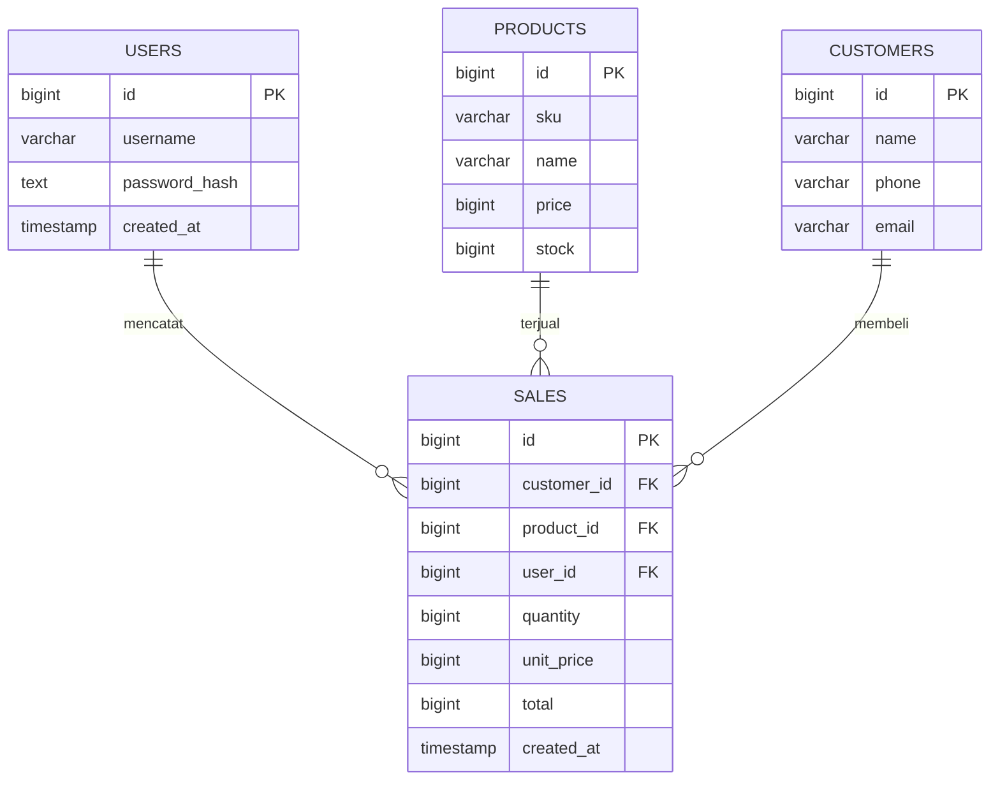

# ERD TokoKita

- **Master**: `products`, `customers`.
- **Transaksi**: `sales`.
- **Login/Register**: `users`.
- **Report**: hasil query JOIN tabel `sales`, `products`, `customers`; tidak membutuhkan tabel baru.
